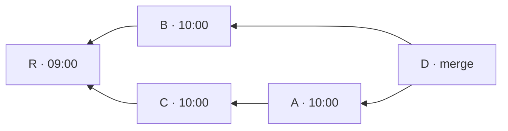

<!-- translation-of: 0044-the-packs-module-drives-the-self-check-in-an-order-of-its-own.md sha256:645876053d7b737f -->
# ADR-0044 · El módulo packs dirige la autocomprobación en un orden propio

**Estado:** aceptada

## Contexto

La [ADR-0041](0041-the-environment-of-a-verified-project-is-a-dockerfile.es.md) dice qué prueba la
autocomprobación de un pack: entre los últimos commits que cambian un test y código que no es test,
al menos dos de los diez primeros tienen un test que falla en el padre y pasa en el commit. La
[ADR-0042](0042-a-port-of-the-project-repository-composes-the-trees-that-are-built.es.md) da el
puerto que compone los árboles, y la
[ADR-0043](0043-tests-run-only-on-an-engine-that-enforces-the-limits.es.md) los motores que los
ejecutan. Quedaba abierto qué módulo dirige el bucle, qué significa "los últimos commits" y qué
cuenta como testigo. Cómo se lee un informe es una decisión aparte.

## Decisión

### Quién la ejecuta

- **`packs` dirige la autocomprobación.** Elige los candidatos, pide al puerto del repositorio del
  proyecto cada árbol, ejecuta los tests en los dos lados y aplica la regla de los testigos. Recibe
  los puertos de `interfaces`.
- **Una operación reutilizable.** El bucle se apoya en una operación de `packs`: ejecutar los tests
  de un pack sobre un directorio y dar el resultado de cada test. `verify` usa la misma operación
  en el hito A3.

### El orden de los candidatos

- **El puerto da la historia y `packs` la ordena.** El puerto del repositorio del proyecto da la
  historia desde un commit: todos los commits alcanzables desde él, con su fecha de commit y sus
  padres en el orden en que el commit los nombra. Esto enmienda la ADR-0042, donde el puerto lista
  commits.
- **La regla de orden es nuestra.**
  - Ningún commit va antes que un commit que desciende de él.
  - Entre los commits que pueden ir a continuación, va primero el de fecha de commit más reciente.
  - Si las fechas son iguales, va primero el que pasó antes a poder ir a continuación. Un commit
    pasa a poder ir a continuación cuando ya están colocados todos los commits que descienden de
    él. Los padres de un commit pasan a poder ir en el orden en que el commit los nombra.
  - Un commit que no tiene exactamente un padre se deja fuera, a propósito. Eso quita los merges
    y los primeros commits, y un candidato necesita un padre.
- **Lo que tiene que hacer un adaptador del repositorio.** Ignora los objetos de reemplazo
  (`git replace`) y rechaza un clon superficial.

Un ejemplo del empate. `D` une `A` y `B`, y nombra primero a `A`. `C` es el padre de `A`. `A`, `B`
y `C` tienen la misma fecha de commit, y `R`, el padre de `B` y de `C`, es más antiguo.

| Paso | Pueden ir a continuación, en el orden en que pasaron a poder ir | Colocado |
|---|---|---|
| 1 | `D` | `D` |
| 2 | `A`, `B`: los padres de `D`, en el orden en que `D` los nombra | `A` |
| 3 | `B`, y después `C`, que pasó a poder ir al colocar `A` | `B` |
| 4 | `C` | `C` |
| 5 | `R`, que puede ir una vez colocados `B` y `C` | `R` |

`B` va antes que `C` aunque `C` sea el padre del commit que se acaba de colocar: `B` pasó antes a
poder ir. Dejando fuera `D`, un merge, y `R`, un primer commit, los candidatos son `A`, `B`, `C`.
`git rev-list --date-order --no-merges` da `A`, `B`, `C`, `R` sobre la misma historia.

### Qué cuenta

- **Un testigo es un test que pasa de rojo a verde.** No es un commit que corrige un defecto.
  Cuentan las refactorizaciones y las funciones que se quitan, porque la regla mide lo que necesita
  el pack: que el entorno muestre a un test cambiar de estado.
- **Los candidatos que no pueden ser testigos siguen siendo candidatos.** Eso incluye un commit que
  solo cambia tests y documentación, y uno cuyos tests solo se adaptaron (mdformat `10307b9`). El
  pack no tiene ningún campo para excluirlos.
- **Los números se mantienen: dos testigos entre los diez primeros candidatos.**
- **Una ejecución cuyo informe no se puede leer deja la autocomprobación en `ERROR`.** El candidato
  no se descarta en silencio, para que un pack nunca se juzgue con menos candidatos de los que dice
  la regla.

## Base

Comprobado el 2026-11-12 y el 2026-11-13, sobre clones locales del corpus (cachetools `1ce79ef`,
python-semver `b6e83e3`, mdformat `56b24ef`), sin tocar los originales.

- **Autocomprobación.**
  - cachetools dio 7 testigos entre los 10 primeros candidatos, python-semver 8 y mdformat 4.
  - Un pack de cachetools que instala la versión publicada en PyPI en lugar del código que se
    prueba dio 0 de 10.
  - Entre los testigos hay refactorizaciones y funciones que se quitan.
  - Dos candidatos no pueden ser testigos por las razones de arriba: cachetools `6a89b7c` y
    python-semver `f3c7138` solo cambian tests y documentación, y mdformat `10307b9` solo adapta
    sus tests a un fixture nuevo.
- **Orden.**
  - Leído en el manual de `git rev-list`:
    - el orden por defecto es "orden cronológico inverso";
    - `--date-order` no muestra un padre antes que todos sus hijos, y por lo demás sigue la fecha
      del commit;
    - `--topo-order` da dos salidas válidas para el ejemplo del propio manual;
    - no dice nada de las fechas iguales.
  - Probado en repositorios hechos para la prueba:
    - con un hijo más antiguo que su padre, el orden por defecto mostró primero el padre, y
      `--date-order` no;
    - las fechas iguales se resolvieron por el orden de los padres en el merge, como en el ejemplo
      de arriba, que se construyó y se ejecutó;
    - la salida fue idéntica con git 2.32.0, 2.40.1, 2.47.3 y 2.54.0, con y sin grafo de commits,
      y en un clon recién hecho;
    - un `git replace --graft` cambió una lista de 7 commits a 1, y `--no-replace-objects` la
      restauró;
    - un clon con `--depth 3` dio 3 commits en lugar de 6.
  - La regla de arriba, escrita en 25 líneas de Python sobre `git log --format='%H %ct %P'`, dio
    exactamente la salida de `git rev-list --date-order --no-merges`, empates incluidos, tras
    quitar las raíces. Se comparó en seis repositorios: dos hechos para la prueba, los tres del
    corpus y el repositorio del propio git (82 925 commits, 61 446 en la lista).
  - En git, leer la historia tardó 3,4 s y ordenarla 0,65 s, con 75 MB de memoria.

No comprobado: macOS y Windows; repositorios mayores que el de git.

## Alternativas consideradas

- **Un servicio de dominio nuevo dirige la autocomprobación.** Duplicaría en otro módulo la regla
  que tiene `packs`. `verify`, el otro candidato, no existe en A2.
- **El orden que da `git rev-list`, exigido solo al adaptador de git.** Un segundo adaptador no
  tendría nada que cumplir. Los empates dependen de un comportamiento de git que su manual no dice.
- **`--topo-order` o el orden por fecha de autor.** El manual del primero admite dos salidas. La
  fecha de autor la pone quien escribe el commit y no es la fecha de la historia.
- **El orden en `core`.** Solo lo necesita la autocomprobación; la auditoría de A3 no.
- **Un campo del pack para excluir candidatos**, como rutas que no cuentan como código. Los tres
  packs pasan sin él.
- **Descartar un candidato cuyo informe no se puede leer** y tomar el siguiente. El pack se
  juzgaría con candidatos que la regla no eligió, y un informe difícil de leer decidiría cuáles.

## Consecuencias

- La autocomprobación da los mismos diez primeros candidatos en cualquier máquina y con cualquier
  adaptador.
- Ordenar carga toda la historia. Se ha medido hasta 82 925 commits, no más.
- Un clon superficial no se puede autocomprobar. Tampoco un repositorio cuya historia solo difiere
  por objetos de reemplazo.
- `verify` en A3 ejecuta los tests con la misma operación que la autocomprobación.
- Un pack entre cuyos candidatos hay commits que no pueden ser testigos necesita más testigos entre
  el resto. Los tres packs del corpus pasan de todos modos.
- Se enmienda la ADR-0042: el puerto da la historia en lugar de listar commits. La fila del
  repositorio del proyecto en el mapa de módulos cambia con ella.
- La regla de orden y la exclusión son requisitos de `packs`, que se escriben cuando se abra su
  alcance.
