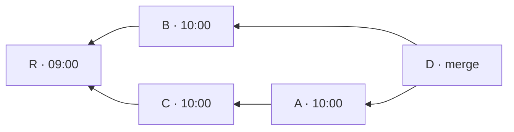

# ADR-0044 · The packs module drives the self-check in an order of its own

**Status:** proposed

## Context

[ADR-0041](0041-the-environment-of-a-verified-project-is-a-dockerfile.md) says what the self-check
of a pack proves: among the latest commits that change a test and code that is not a test, at
least two of the first ten have a test that fails on the parent and passes on the commit.
[ADR-0042](0042-a-port-of-the-project-repository-composes-the-trees-that-are-built.md) gives the
port that composes the trees, and
[ADR-0043](0043-tests-run-only-on-an-engine-that-enforces-the-limits.md) the engines that run
them. Still open: which module drives the loop, what "the latest commits" means, and what counts
as a witness. How a report is read is a decision of its own.

## Decision

### Who runs it

- **`packs` drives the self-check.** It chooses the candidates, asks the port of the project
  repository for each tree, runs the tests on both sides and applies the rule of witnesses. It
  receives the ports from `interfaces`.
- **One reusable operation.** The loop is built on one operation of `packs`: run the tests of a
  pack on a directory and give the outcome of each test. `verify` uses the same operation in
  milestone A3.

### The order of the candidates

- **The port gives the history, and `packs` orders it.** The port of the project repository gives
  the history from a commit: every commit reachable from it, with its commit date and its parents
  in the order the commit names them. This amends ADR-0042, where the port lists commits.
- **The rule of order is ours.**
  - No commit is placed before a commit that descends from it.
  - Among the commits that can come next, the one with the later commit date goes first.
  - On equal dates, the one that became able to come next earlier goes first. A commit becomes
    able to come next when every commit that descends from it has been placed. The parents of a
    commit become able in the order the commit names them.
  - A commit that does not have exactly one parent is left out, on purpose. That removes the
    merges and the first commits, and a candidate needs one parent.
- **What an adapter of the repository must do.** It ignores replace objects (`git replace`) and
  refuses a shallow clone.

An example of the tie. `D` merges `A` and `B`, naming `A` first. `C` is the parent of `A`. `A`,
`B` and `C` have the same commit date, and `R`, the parent of `B` and `C`, is older.

| Step | Can come next, in the order they became able | Placed |
|---|---|---|
| 1 | `D` | `D` |
| 2 | `A`, `B`: the parents of `D`, in the order `D` names them | `A` |
| 3 | `B`, then `C`, which became able when `A` was placed | `B` |
| 4 | `C` | `C` |
| 5 | `R`, able once `B` and `C` are placed | `R` |

`B` goes before `C` although `C` is the parent of the commit placed just before: `B` became able
first. Leaving out `D`, a merge, and `R`, a first commit, the candidates are `A`, `B`, `C`.
`git rev-list --date-order --no-merges` gives `A`, `B`, `C`, `R` on the same history.

### What counts

- **A witness is a test that goes from red to green.** It is not a commit that fixes a defect.
  Refactors and removed features count, because the rule measures what the pack needs: that the
  environment shows a test change state.
- **Candidates that cannot be witnesses stay candidates.** That covers a commit that changes only
  tests and documentation, and one whose tests were only adapted (mdformat `10307b9`). The pack
  has no field to exclude them.
- **The numbers stay: two witnesses among the first ten candidates.**
- **A run whose report cannot be read makes the self-check `ERROR`.** The candidate is not dropped
  in silence, so that a pack is never judged on fewer candidates than the rule says.

## Basis

Verified on 2026-11-12 and 2026-11-13, on local clones of the corpus (cachetools `1ce79ef`,
python-semver `b6e83e3`, mdformat `56b24ef`), the originals untouched.

- **Self-check.**
  - cachetools gave 7 witnesses among the first 10 candidates, python-semver 8 and mdformat 4.
  - A pack of cachetools that installs the released version from PyPI instead of the code under
    test gave 0 of 10.
  - Among the witnesses there are refactors and removed features.
  - Two candidates cannot be witnesses for the reasons above: cachetools `6a89b7c` and
    python-semver `f3c7138` change only tests and documentation, and mdformat `10307b9` only
    adapts its tests to a new fixture.
- **Order.**
  - Read in the manual of `git rev-list`:
    - the default order is "reverse chronological";
    - `--date-order` shows no parent before all its children, and otherwise follows the commit
      timestamp;
    - `--topo-order` gives two valid outputs for the example of the manual itself;
    - nothing is said about equal dates.
  - Tested in repositories made for the test:
    - with a child older than its parent, the default order showed the parent first, and
      `--date-order` did not;
    - equal dates were broken by the order of the parents in the merge, as in the example above,
      which was built and run;
    - the output was identical with git 2.32.0, 2.40.1, 2.47.3 and 2.54.0, with and without a
      commit graph, and in a fresh clone;
    - a `git replace --graft` changed a list of 7 commits to 1, and `--no-replace-objects`
      restored it;
    - a clone with `--depth 3` gave 3 commits instead of 6.
  - The rule above, written in 25 lines of Python over `git log --format='%H %ct %P'`, gave
    exactly the output of `git rev-list --date-order --no-merges`, ties included, once roots were
    removed. It was compared on six repositories: two made for the test, the three of the corpus,
    and the repository of git itself (82,925 commits, 61,446 listed).
  - On git, reading the history took 3.4 s and ordering it 0.65 s, with 75 MB of memory.

Not checked: macOS and Windows; repositories larger than git's.

## Alternatives considered

- **A new domain service drives the self-check.** It would duplicate in another module the rule
  that `packs` holds. `verify`, the other candidate, does not exist in A2.
- **The order given by `git rev-list`, required of the git adapter only.** A second adapter would
  have nothing to match. Ties depend on a behaviour of git that its manual does not state.
- **`--topo-order` or the order by author date.** The manual of the first allows two outputs.
  The author date is set by whoever writes the commit and is not the date of the history.
- **The order in `core`.** Only the self-check needs it; the audit of A3 does not.
- **A field of the pack to exclude candidates**, such as paths that do not count as code. All
  three packs pass without it.
- **Drop a candidate whose report cannot be read** and take the next one. The pack would be
  judged on candidates that the rule did not choose, and a report that is hard to read would
  decide which.

## Consequences

- The self-check gives the same first ten candidates on every machine and with every adapter.
- Ordering loads the whole history. That was measured up to 82,925 commits, not beyond.
- A shallow clone cannot be self-checked. Neither can a repository where the history differs
  only through replace objects.
- `verify` in A3 runs tests with the same operation as the self-check.
- A pack whose candidates include commits that cannot be witnesses needs more witnesses among the
  rest. The three packs of the corpus pass anyway.
- ADR-0042 is amended: the port gives the history instead of listing commits. The row of the
  project repository in the module map changes with it.
- The rule of order and the exclusion are requirements of `packs`, written when its scope opens.
