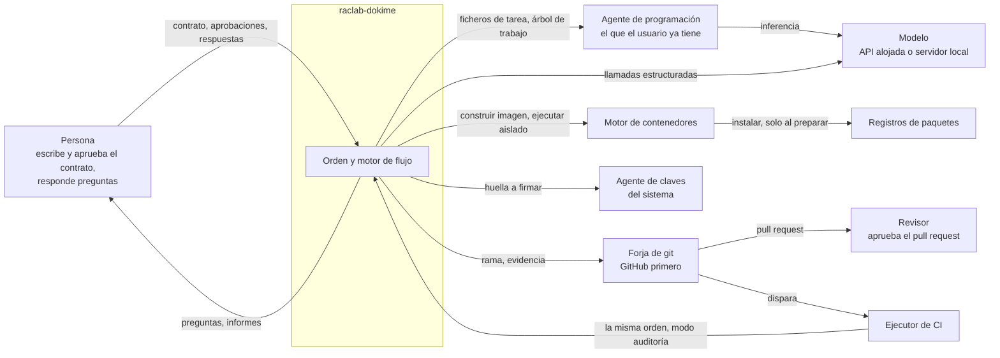
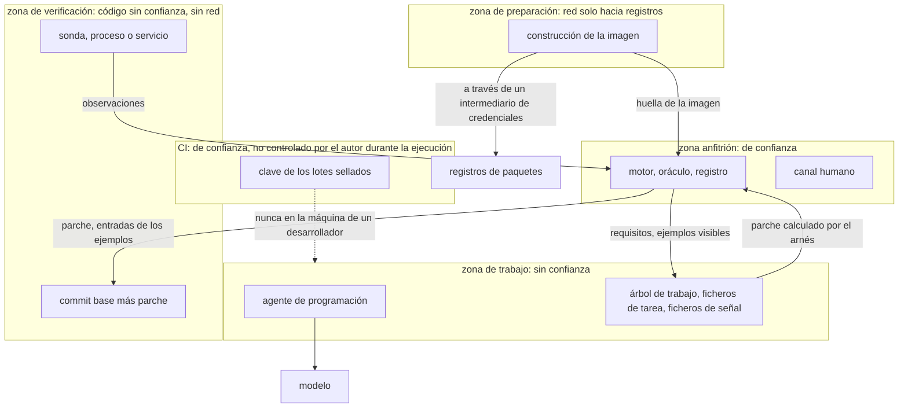

<!-- translation-of: 01-context.md sha256:d91ce48eff068148 -->
# Contexto y zonas de confianza

*Read in [English](01-context.md).*

## Con quién habla el sistema

raclab-dokime es una orden que corre en la máquina de una persona y, con el mismo código, en un
ejecutor de CI. No tiene servidor propio.

Tres cosas que fija el diagrama:

- El agente es **externo**. El arnés le entrega ficheros y lee el árbol de trabajo de vuelta. No
  conoce su protocolo interno ni su modelo.
- El arnés hace sus propias llamadas a un modelo por una vía separada del agente
  ([ADR-0022](../adr/0022-model-calls-of-the-harness-go-through-a-port.es.md)).
- CI ejecuta **el mismo programa** en modo auditoría. No hay una segunda implementación de las
  puertas.

## Zonas de confianza

| Zona | Qué corre | Red | Ve secretos | Ve ejemplos reservados |
|---|---|---|---|---|
| Anfitrión | El arnés | La del usuario | A través del agente de claves | Solo donde está la clave: CI, o la máquina de un desarrollador solo |
| Preparación | La construcción de la imagen | Registros permitidos, por un intermediario | No | No |
| Trabajo | El agente | La suya, o filtrada cuando el envoltorio está activo | La sesión del agente | No |
| Verificación | El código escrito por el agente | Ninguna | No | Solo las **entradas** |

Qué cruza cada frontera:

- De anfitrión a trabajo: requisitos, ejemplos visibles, la lista de tests en riesgo,
  realimentación.
- De trabajo a anfitrión: el árbol de trabajo, del que el arnés calcula el parche, y ficheros de
  señal leídos como datos.
- De anfitrión a verificación: el commit base, el parche filtrado y entradas.
- De verificación a anfitrión: observaciones y ficheros de resultados, leídos como datos.

Dos puntos a tener a la vista:

- Aislar la zona de trabajo **protege la máquina y los secretos del usuario**. La corrección del
  veredicto no depende de ello: depende de que la verificación parta del commit base y de que los
  valores esperados no entren en la zona de verificación. Por eso aislar al agente es opcional y
  la verificación no
  ([ADR-0020](../adr/0020-agent-isolation-is-optional-adoption-is-a-ladder.es.md)).
- Qué se defiende y qué no está en el modelo de amenazas
  ([ADR-0010](../adr/0010-threat-model.es.md)).
