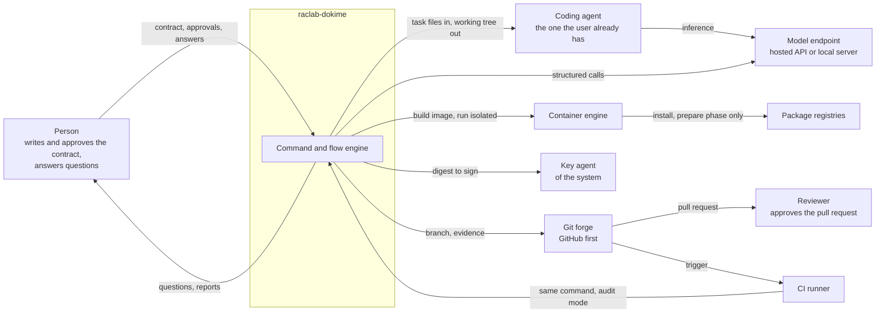
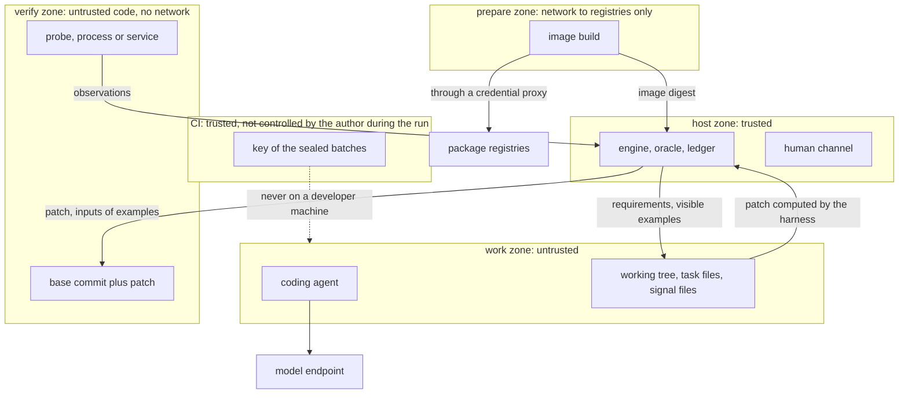

# Context and trust zones

*Leer en [español](01-context.es.md).*

## Who the system talks to

raclab-dokime is a command that runs on a person's machine and, with the same code, on a CI
runner. It has no server of its own.

Three things the diagram fixes:

- The agent is **external**. The harness gives it files and reads the working tree back. It knows
  neither its internal protocol nor its model.
- The harness makes its own model calls on a route separate from the agent
  ([ADR-0022](../adr/0022-model-calls-of-the-harness-go-through-a-port.md)).
- CI runs **the same program** in audit mode. There is no second implementation of the gates.

## Trust zones

| Zone | What runs | Network | Sees secrets | Sees held-out examples |
|---|---|---|---|---|
| Host | The harness | The user's | Through the key agent | Only where the key is: CI, or a single developer's machine |
| Prepare | The image build | Allowed registries, through a proxy | No | No |
| Work | The agent | The agent's own, or filtered when the wrapper is on | The agent's session | No |
| Verify | The code written by the agent | None | No | Only the **inputs** |

What crosses each boundary:

- Host to work: requirements, visible examples, the list of tests at risk, feedback.
- Work to host: the working tree, from which the harness computes the patch, and signal files read
  as data.
- Host to verify: the base commit, the filtered patch and inputs.
- Verify to host: observations and result files, read as data.

Two points to keep in view:

- Isolating the work zone **protects the user's machine and secrets**. The correctness of the
  verdict does not depend on it: it depends on verification starting from the base commit and on
  the expected values not entering the verify zone. That is why isolating the agent is optional
  and verification is not ([ADR-0020](../adr/0020-agent-isolation-is-optional-adoption-is-a-ladder.md)).
- What is defended and what is not is in the threat model ([ADR-0010](../adr/0010-threat-model.md)).
