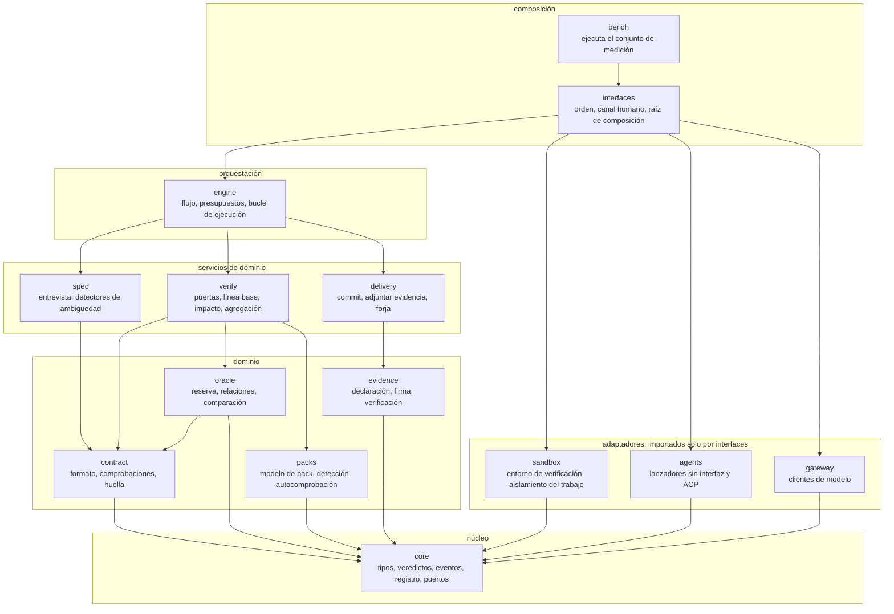

<!-- translation-of: 02-modules.md sha256:e06e52a03455149b -->
# Módulos

*Read in [English](02-modules.md).*

## Mapa de módulos

## Qué hace cada módulo

| Módulo | Responsabilidad | No hace |
|---|---|---|
| `core` | Tipos, el álgebra de veredictos, el registro con huellas encadenadas, la definición de los puertos | Entrada ni salida, salvo escribir el registro por un puerto |
| `contract` | Leer, validar y dar huella a un contrato: sintaxis EARS, esquema de ejemplos, cobertura de requisitos por ejemplos, contradicciones | Ejecutar nada |
| `oracle` | Repartir los ejemplos en visibles y sellados; aplicar relaciones; comparar observaciones con lo esperado; redactar la realimentación | Ejecutar el código examinado. Recibe observaciones |
| `packs` | Modelo de pack, detección del tipo de proyecto, autocomprobación | Saber de lenguajes en código. Todo es declarativo |
| `evidence` | Construir la atestación, pedir firmas, **verificar** un fichero de evidencia sin el resto | Decidir veredictos |
| `verify` | Las puertas, la línea base, el mapa de impacto por cobertura, la agregación | Hablar con el agente ni con la persona |
| `spec` | Entrevista, detectores de ambigüedad, el solucionador donde aplique | Aprobar. Solo propone |
| `delivery` | Commit, adjuntar la evidencia, abrir el pull request | Verificar |
| `engine` | Cargar y validar el flujo, ejecutarlo, llevar los presupuestos, empaquetar la tarea para el agente | Contener lógica de puertas |
| `sandbox` | Adaptadores del entorno de verificación y del aislamiento del agente | Decidir la política. La recibe |
| `agents` | Adaptadores que lanzan agentes | Interpretar el resultado. El parche lo calcula el arnés |
| `gateway` | Adaptadores de modelo, prompts registrados, validación de respuestas contra un esquema | Decidir |
| `interfaces` | La orden, el canal humano, la raíz de composición | Contener lógica de dominio |
| `bench` | Ejecutar el conjunto de medición y calcular las métricas | Formar parte del producto instalado |

## Reglas de dependencia

Se convierten en contratos de importación en CI
([ADR-0031](../adr/0031-modules-depend-only-on-core.es.md)):

1. `core` no importa ningún otro módulo del paquete.
2. Los módulos de la capa de dominio importan solo `core`, y `oracle` importa además `contract`.
3. Los servicios de dominio importan la capa de dominio y `core`. No se importan entre sí.
4. `engine` importa los servicios de dominio, la capa de dominio y `core`.
5. `sandbox`, `agents` y `gateway` importan solo `core`. Implementan puertos definidos allí.
6. Solo `interfaces` importa adaptadores. Es la única raíz de composición, y `bench` la usa.
7. `evidence` no importa nada más que `core`.

## Puertos

Todos se definen en `core`. Cada uno tiene dos adaptadores previstos; los marcados con ① son del
primer bloque.

| Puerto | Contrato resumido | Adaptadores |
|---|---|---|
| Entorno de verificación | Construir una imagen desde un pack y un commit; ejecutar una orden en ella sin red, con montajes de solo lectura y límites | ① Docker, Podman |
| Aislamiento del trabajo | Abrir una sesión de trabajo con rutas de escritura, rutas de lectura denegadas y destinos de red permitidos; declarar su nivel | Ninguno, envoltorio del sistema operativo, microVM |
| Lanzador de agentes | Ejecutar una tarea en una sesión de trabajo; devolver la identidad del agente y su estado de salida | Modo sin interfaz por perfil de agente, ACP |
| Pasarela de modelos | Dada una plantilla registrada, sus entradas y un esquema, devolver JSON válido o un error | API compatible con OpenAI, API de fabricante, el agente instalado |
| Canal humano | Presentar una pregunta tipada; devolver una respuesta con identidad y marca de delegación | ① terminal, ① ficheros, ninguno para CI, formularios de MCP |
| Firmante | Firmar una huella con un propósito declarado | ① agente de claves del sistema, firma sin clave, la atestación del ejecutor de CI |
| Almacén de lo sellado | Guardar y recuperar material sellado, cifrado para una lista de destinatarios | Un fichero cifrado en el repositorio |
| Almacén de evidencia | Guardar y recuperar evidencia por la huella de su sujeto | ① fichero, notas de git, el almacén de atestaciones de la forja |
| Forja | Crear una rama, publicar, abrir un pull request | GitHub; local sin forja |
| Reloj, azar | Fuentes de tiempo y de aleatoriedad que se pueden inyectar | Sistema; fijos para la repetición |

## Orden de construcción

Los módulos se construyen en siete bloques, empezando por auditar
([ADR-0029](../adr/0029-build-order-starts-with-auditing.es.md),
[hoja de ruta](../ROADMAP.es.md)).

## Qué se reutiliza y qué se construye

| Pieza | Decisión |
|---|---|
| Motor de contenedores | Se reutiliza |
| Envoltorio del sistema operativo para el agente | Se reutiliza, detrás de un puerto, porque el disponible es experimental |
| Lanzamiento de agentes | Primero el modo sin interfaz propio de cada agente; ACP como segundo adaptador |
| Formato del entorno | Un Dockerfile o un devcontainer que el proyecto ya tenga |
| Formato de la evidencia | in-toto, DSSE y herramientas de firma existentes |
| Arneses de evaluación y meta-arneses | No se depende de ellos; posibles adaptadores más adelante |
| Contrato, oráculo, puertas, agregación, predicado de la evidencia | **Se construye.** Es lo que no existe, y es el producto |
