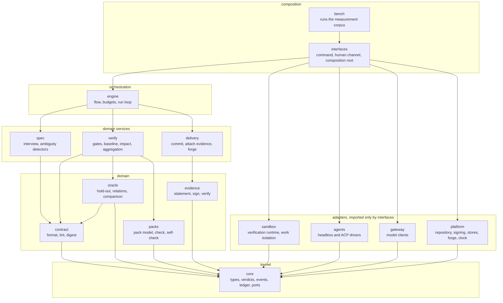

# Modules

*Leer en [español](02-modules.es.md).*

## Module map

## What each module does

| Module | Responsibility | Does not |
|---|---|---|
| `core` | Types, the algebra of verdicts, the ledger with chained hashes, the schema and the validator of the flow, the definition of the ports | Do input or output, except writing the ledger through a port |
| `contract` | Read, validate and digest a contract: EARS syntax, example schema, coverage of requirements by examples, contradictions | Run anything |
| `oracle` | Split examples into visible and sealed; apply relations; compare observations with what is expected; word the feedback | Run the code under test. It receives observations |
| `packs` | Pack model, the check of a pack, self-check | Know languages in code. Everything is declarative |
| `evidence` | Build the attestation, ask for signatures, **verify** an evidence file without the rest | Decide verdicts |
| `verify` | The gates, the baseline, the impact map from coverage, the aggregation | Talk to the agent or to the person |
| `spec` | Interview, ambiguity detectors, the solver where it applies | Approve. It only proposes |
| `delivery` | Commit, attach the evidence, open the pull request | Verify |
| `engine` | Run a validated flow, keep the budgets, ask the questions, package the task for the agent | Hold gate logic |
| `sandbox` | Adapters for the verification runtime and for isolating the agent | Decide policy. It receives it |
| `agents` | Adapters that launch agents | Interpret the result. The harness computes the patch |
| `gateway` | Model adapters, registered prompts, validation of answers against a schema | Decide |
| `platform` | Adapters of the project repository, the signer, the sealed store, the evidence store and the forge, and the system clock and randomness | Decide, or hold domain logic |
| `interfaces` | The command, the human channel, the composition root | Hold domain logic |
| `bench` | Run the measurement corpus and compute the metrics | Ship with the installed product |

## Dependency rules

They become import contracts in CI ([ADR-0031](../adr/0031-modules-depend-only-on-core.md)):

1. `core` imports no other module of the package.
2. The modules of the domain layer import only `core`, and `oracle` also imports `contract`.
3. The domain services import the domain layer and `core`. They do not import each other.
4. `engine` imports the domain services, the domain layer and `core`.
5. `sandbox`, `agents`, `gateway` and `platform` import only `core`. They implement ports defined there.
6. Only `interfaces` imports adapters. It is the single composition root, and `bench` uses it.
7. `evidence` imports nothing but `core`.

## Ports

All are defined in `core`. Each has at least two adapters foreseen; those marked ① belong to the first
block.

| Port | Contract in short | Adapters |
|---|---|---|
| Verification runtime | Build an image from a Dockerfile and a directory; run a command in it without network, with read-only mounts and limits; read the report it wrote and give the outcome of each test | ① Docker, Podman |
| Project repository | Give the history from a commit, each commit with its date and its parents; give the parent and the changed paths of a commit; compose a tree from a commit with paths of another commit or with a patch, named by its git tree digest; extract a tree to a directory, byte for byte; refuse a tree with a submodule | ① the `git` command; a git library |
| Work isolation | Open a work session with writable paths, denied read paths and allowed network destinations; report its level | None, operating-system wrapper, micro virtual machine |
| Agent driver | Run a task in a work session; return the identity of the agent and its exit state | Headless mode per agent profile, ACP |
| Model gateway | Given a registered template, its inputs and a schema, return valid JSON or an error | OpenAI-compatible API, vendor API, the installed agent |
| Human channel | Present a typed question; return an answer with identity and delegation flag | ① terminal, ① files, none for CI, MCP forms |
| Signer | Sign a digest with a declared purpose | ① system key agent, keyless signing, the CI runner's attestation |
| Sealed store | Store and retrieve held-out content, encrypted for a list of recipients | An encrypted file in the repository; an encrypted file in the local memory directory |
| Evidence store | Store and retrieve evidence by the digest of its subject | ① file, git notes, the forge's attestation store |
| Forge | Create a branch, publish, open a pull request | GitHub; local without a forge |
| Clock, random | Sources of time and randomness that can be injected | System; fixed for replay |

Where the adapters live: the verification runtime and the work isolation in `sandbox`; the agent
launcher in `agents`; the model gateway in `gateway`; the human channel in `interfaces`; the
project repository, the signer, the sealed store, the evidence store, the forge, the clock and the
randomness in `platform`. No domain module talks to the outside.

## Build order

The modules are built in seven blocks, audit first
([ADR-0029](../adr/0029-build-order-starts-with-auditing.md), [roadmap](../ROADMAP.md)).

## What is reused and what is built

| Piece | Decision |
|---|---|
| Container engine | Reused |
| Operating-system wrapper for the agent | Reused, behind a port, because the available one is experimental |
| Agent launching | Each agent's own headless mode first; ACP as the second adapter |
| Environment format | A Dockerfile or a devcontainer the project already has |
| Evidence format | in-toto, DSSE and existing signing tools |
| Evaluation harnesses and meta-harnesses | Not depended on; possible adapters later |
| Contract, oracle, gates, aggregation, evidence predicate | **Built.** It is what does not exist, and it is the product |
