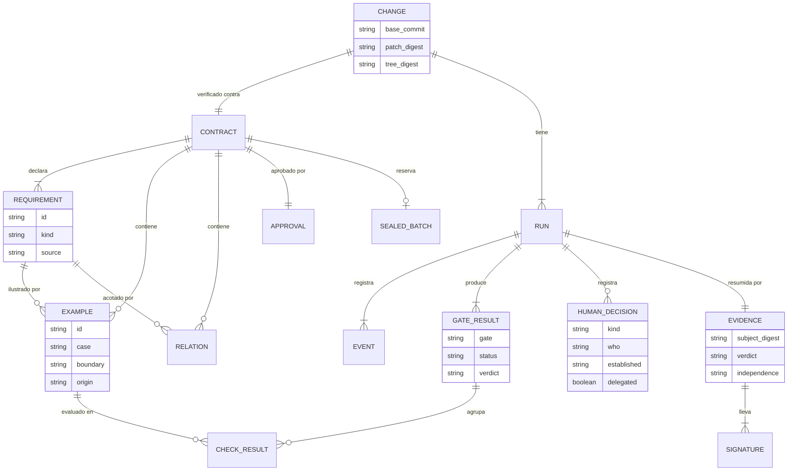
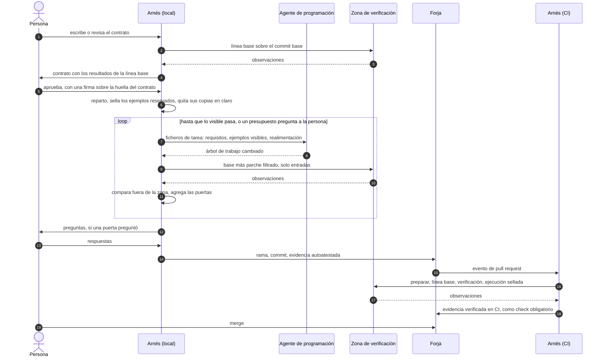

<!-- translation-of: 03-data-and-evidence.md sha256:5daf4433a78c9bb2 -->
# Datos y evidencia

*Read in [English](03-data-and-evidence.md).*

Qué deja escrito el arnés, dónde lo guarda y qué contiene la evidencia de un cambio. Los términos
son los del [glosario](glossary.es.md).

Los formatos que aparecen aquí son el punto de partida del bloque A. El primer hito de ese bloque
escribe a mano tres contratos reales ([hoja de ruta](../ROADMAP.es.md)); si no encajan, los
formatos cambian antes de que ningún código dependa de ellos. Los nombres de ficheros y
directorios son provisionales.

## Los datos



## Dónde vive

Una sola estructura, se guarde en el repositorio o, para un desarrollador solo, en un directorio
local sin git ([ADR-0027](../adr/0027-memory-has-one-layout-and-three-scopes.es.md)).

| Alcance | Qué | Dónde |
|---|---|---|
| Proyecto | Política, pack, flujo, lista de firmantes permitidos, ficheros de memoria | `.dokime/` |
| Cambio | Contrato, aclaraciones, aprobación, lote sellado | `.dokime/changes/<historia>/`, en la rama del cambio |
| Persona | Registro de cada ejecución, artefactos guardados, propuestas sin aprobar, la clave cuando es local | El directorio de estado del arnés, fuera del árbol de trabajo |

De decisiones ya tomadas se siguen dos reglas:

- **La evidencia nunca vive dentro del árbol que describe.** Su sujeto es la huella del árbol, y
  un fichero añadido al árbol cambiaría esa huella. La guarda el almacén de evidencia: un fichero
  junto al pull request, notas de git o el almacén de atestaciones de la forja.
- **La lista de firmantes permitidos, la política, el pack y el flujo son rutas protegidas.** Un
  cambio en ellos hecho por el agente se descarta del parche.

## El contrato

Un fichero YAML con requisitos, ejemplos y relaciones
([ADR-0011](../adr/0011-contract-of-requirements-and-approved-examples.es.md),
[ADR-0012](../adr/0012-examples-are-observations-at-a-boundary.es.md)).

```yaml
format: 1                       # versión del formato del fichero
story: invoice-rounding         # identifica el contrato
may_modify_tests: []            # ficheros de test que el cambio puede editar

requirements:
  - id: round-total-once        # descriptivo, lo elige la persona
    kind: new                   # new | change | preserve
    text: When an invoice has lines in several currencies, the system shall round the total once.
    source: written             # written | imported, con la herramienta y el fichero de origen
  - id: round-each-line-first
    kind: change
    replaces: round-per-line    # solo en un cambio: el comportamiento que sustituye
    text: …
    source: written

examples:
  - id: E-4f1a                  # opaco, aleatorio, lo asigna el arnés una sola vez
    requirement: round-total-once
    case: normal
    boundary: cli               # function | cli | http
    target: invoice             # lo que se invoca: una orden, una función o una ruta
    description: Two lines in euros whose sum needs rounding.   # opcional, una línea
    origin: human               # una propuesta tiene origen model hasta que una persona la acepta
    steps:
      - input:
          args: [total, invoice.json]
          files: {invoice.json: {$json: {lines: [{amount: 3.335, currency: EUR}, {amount: 6.695, currency: EUR}]}}}
        expect:
          exit: 0
          stdout: {$json: {total: {$approx: 10.03, tolerance: 0.005}}}
          files: {}             # ficheros que deben existir después, cuando la frontera es cli

relations:
  - id: L1
    requirement: round-total-once
    relation: order-insensitive   # del catálogo cerrado
    over: lines
```

- **Lo que un paso puede esperar** es un valor exacto o uno de los comparadores del catálogo
  cerrado: cualquier identificador o marca de tiempo (`$any`), número aproximado (`$approx`),
  colección sin orden (`$unordered`), contiene (`$contains`), patrón (`$pattern`), referencia a un
  paso anterior (`$ref`). El catálogo de relaciones incluye `idempotent` (aplicar la operación dos
  veces da lo mismo que aplicarla una).
- **La entrada de un paso en la frontera `function`** es `args` y `kwargs`, y nada más.
- **El texto del requisito es canónico en inglés.** A la persona se le puede mostrar en otro
  idioma; la aprobación registra la huella de lo que se le mostró
  ([ADR-0032](../adr/0032-bilingual-interaction-signs-what-was-shown.es.md)).
- **Un requisito dice de dónde vino.** Uno importado de una especificación hecha con otra
  herramienta es una propuesta como cualquier otra
  ([ADR-0033](../adr/0033-a-specification-from-another-tool-enters-as-proposals.es.md)).
- **Identificadores.** El id de un requisito es descriptivo, porque la persona lo lee y lo elige.
  El id de un ejemplo es opaco y aleatorio, porque un id derivado del contenido se podría adivinar
  y diría algo de un ejemplo reservado.
- **Un texto de varias líneas declara su salto de línea final.** Un texto de varias líneas, en una
  entrada o en una expectativa, se escribe con la directiva `$text`, como bloque literal, con un
  `final_newline` obligatorio:

  ```yaml
  stdout:
    $text: |
      total: 10.03
      lines: 2
    final_newline: true
  ```

  El bloque siempre da un valor que acaba en un salto de línea; `final_newline: false` lo quita
  para obtener el texto real, y `true` lo conserva. Que un texto acabe o no en salto de línea
  decide si un ejemplo pasa, y no puede depender de un guion que nadie ve.
- **Las directivas se marcan con `$`**
  ([ADR-0038](../adr/0038-directives-in-a-contract-are-marked-with-a-dollar.es.md)). Un mapa con
  una clave que empieza por `$` es una instrucción para el arnés: `$text`, `$json`, `$literal` y
  los comparadores. Cualquier otro mapa es un dato tal como está escrito, así que una función que
  devuelve un mapa con una clave `approx` no se confunde con un comparador.
- **Un contrato se lee con reglas estrictas propias**
  ([ADR-0037](../adr/0037-a-contract-is-read-by-strict-rules-of-its-own.es.md)). Un solo
  documento, sin anclas, alias, etiquetas ni claves de fusión. Una clave o un id repetidos son un
  defecto. Un valor sin comillas que los lectores de YAML tipan de forma distinta (`no`, `010`,
  `1.10`, una fecha, un valor vacío) se rechaza pidiendo comillas. Un texto de varias líneas que
  no es un bloque literal se rechaza. El validador informa de todos los hallazgos en una sola
  ejecución, cada uno con sus líneas.
- **Un ejemplo no ensancha su requisito.** Si un ejemplo fija un comportamiento que el texto de su
  requisito no dice (un número negativo, una lista vacía), primero se cambia el requisito, con la
  aprobación de la persona, o el ejemplo no se escribe. La entrevista aplica esta regla y pregunta
  a la persona por un caso límite en vez de decidirlo dentro de un ejemplo.
- **Los comentarios de un contrato** se escriben en inglés y dicen algo. Quedan fuera de la huella
  y de la firma, así que un comentario nunca afirma nada que necesite aprobación: eso va en el
  texto, en la `description` o en un ejemplo. El validador rechaza los campos desconocidos.
- **Lo que se le muestra a la persona para aprobar** marca lo que el fichero no deja ver: los
  espacios finales y el salto de línea final se dibujan de forma visible.

### La huella de un contrato

La huella tiene que seguir siendo verificable después del reparto, cuando el contenido de los
ejemplos reservados ya no está en el fichero. Por eso se calcula sobre las huellas de sus partes,
no sobre el fichero:

1. Cada requisito, ejemplo y relación tiene la huella de su forma canónica. La huella de un
   ejemplo se calcula con una sal aleatoria que se guarda con el ejemplo. Sin ella, un ejemplo
   reservado de contenido corto y adivinable podría encontrarse probando candidatos contra su
   huella.
2. La huella del contrato es la huella de la cabecera y de la lista ordenada de esas huellas.
3. Tras el reparto, el fichero conserva enteros los ejemplos visibles y, de cada ejemplo
   reservado, solo su identificador, su requisito, su caso y su huella. La sal de un ejemplo
   reservado queda bajo la clave, no en el fichero.

Cualquiera puede recalcular la huella del contrato desde el fichero. Solo quien tiene la clave
puede comprobar que una huella reservada corresponde a su contenido.

### La aprobación

```json
{
  "contract": "sha256:c07e…",
  "shown": {"language": "es", "digest": "sha256:aa31…"},
  "who": "rafa",
  "established": "signed",
  "gesture_enforced": true,
  "specified_behind": "wrapper",
  "at": "2026-11-10T15:40:02Z",
  "signature": "…"
}
```

`specified_behind` es la barrera entre el sitio donde se especificó el contrato y el agente:
`other-machine`, `wrapper`, `other-user` o `none`
([ADR-0020](../adr/0020-agent-isolation-is-optional-adoption-is-a-ladder.es.md)).
`gesture_enforced` dice si el agente de claves pidió confirmación o si se tocó una llave física
([ADR-0024](../adr/0024-approval-attestation-and-commit-are-signed-separately.es.md)).

## El registro

Cada ejecución añade eventos a un fichero. Cada evento guarda la huella del anterior
([ADR-0023](../adr/0023-evidence-is-an-attestation-bound-to-the-tree.es.md)).

```json
{"seq": 41, "at": "2026-11-10T16:02:11Z", "type": "gate.finished",
 "gate": "visible-examples", "status": "run", "verdict": "PASS",
 "inputs": {"patch": "sha256:9f2c…", "image": "sha256:41ab…", "contract": "sha256:c07e…"},
 "prev": "sha256:77d0…", "hash": "sha256:e1b4…"}
```

| Evento | Registra |
|---|---|
| `run.started`, `run.finished` | Las huellas de las que parte la ejecución; el estado final |
| `state.entered` | El estado del flujo |
| `gate.started`, `gate.finished` | La puerta, su estado, su veredicto y las huellas de sus entradas |
| `human.asked`, `human.answered` | La pregunta; la respuesta, quién la dio, cómo se estableció y si fue delegada |
| `model.called` | El prompt registrado, el modelo y la huella de la salida, que se guarda |
| `agent.started`, `agent.finished` | El perfil del agente, el modelo y el estado de salida |
| `baseline.unstable` | Los tests excluidos por inestables |
| `budget.exhausted` | El bucle y el estado que pregunta |
| `evidence.built` | La huella de la evidencia |

Los eventos se refieren a los artefactos por su huella; los artefactos se guardan junto al
registro. El contenido reservado nunca está entre ellos: el registro guarda su huella. El estado
de una ejecución se calcula desde su registro.

## La evidencia

Una declaración in-toto en un sobre DSSE, con un predicado propio. Se produce de toda ejecución
terminada, sea cual sea su veredicto.

```json
{
  "_type": "https://in-toto.io/Statement/v1",
  "subject": [
    {"name": "tree", "digest": {"gitTree": "5b1e…"}},
    {"name": "change.patch", "digest": {"sha256": "9f2c…"}}
  ],
  "predicateType": "https://github.com/rafaranaz/raclab-dokime/attestation/conformance/v0.1",
  "predicate": {
    "verdict": "PASS",
    "delivered": true,
    "independence": "self-attested",
    "verifier": {"harness": "0.1.0", "ran_on": "developer"},
    "contract": {"story": "invoice-rounding", "digest": "sha256:c07e…", "approval": "sha256:19d4…"},
    "inputs": {
      "base": "e0ba503…",
      "image": {"digest": "sha256:41ab…", "platform": "linux/amd64"},
      "pack": {"digest": "sha256:77aa…", "level": "P2"},
      "policy": "sha256:0d5f…",
      "flow": "sha256:6c2a…",
      "seeds": {"holdout": "sha256:1f0c…", "relations": "sha256:8e21…"}
    },
    "author": {
      "step": 2, "agent": "example-agent", "agent_version": "1.4.0", "model": "example-model",
      "payment": "subscription", "wrapper": false
    },
    "gates": [
      {"gate": "protected-paths", "status": "run", "verdict": "PASS"},
      {"gate": "existing-tests", "status": "run", "verdict": "PASS",
       "checks": {"origin": "existing", "total": 412, "excluded_unstable": 2}},
      {"gate": "visible-examples", "status": "run", "verdict": "PASS",
       "checks": {"origin": "human", "total": 9}},
      {"gate": "sealed-examples", "status": "not-applicable", "reason": "the key lives only in CI"},
      {"gate": "changed-line-coverage", "status": "skipped", "reason": "optional in the policy"},
      {"gate": "behaviour-differences", "status": "not-applicable", "reason": "pack level P2"}
    ],
    "human_decisions": [
      {"kind": "gate-question", "gate": "model-review", "answer": "not a defect",
       "who": "rafa", "established": "declared", "delegated": false, "at": "2026-11-10T16:20:45Z"}
    ],
    "not_checked": [
      {"code": "no-holdout", "what": "R4", "reason": "no case with two examples"},
      {"code": "gate-skipped", "what": "changed-line-coverage", "reason": "optional in the policy"},
      {"code": "outside-threat-model", "what": "existing-tests", "reason": "they run in the process of the code under test"}
    ],
    "attempts": {"count": 3, "sealed_failures": 0, "disputes": 0},
    "repeated": {"runs": 2, "consistent": true},
    "ledger": {"head": "sha256:e1b4…", "events": 87},
    "informative": {
      "change": {"files": 4, "lines_added": 87, "lines_removed": 12},
      "mutation": {"total": 20, "killed": 17},
      "cost": {"amount": 0.42, "currency": "USD"}
    }
  }
}
```

- **`gates`** lista cada puerta del flujo con uno de cuatro estados: `run`, `skipped`,
  `not-applicable` o `not-reached`. Los tres últimos llevan un motivo calculado por el arnés. Una
  puerta solo es `not-reached` en una ejecución que una puerta anterior detuvo.
- **`not_checked`** es obligatorio y se rellena mecánicamente. Cada entrada lleva un código de una
  lista cerrada y un motivo en palabras. La lista empieza con: `no-holdout`,
  `requirement-without-example`, `only-model-checks`, `gate-skipped`, `test-excluded-unstable`,
  `test-excluded-network`, `boundary-not-supported`, `best-effort-secrecy`, `outside-threat-model`.
- **`independence`** es `self-attested`, `ci-verified` o `ci-verified, second-approver`.
- **`informative`** no lo lee ninguna puerta y no decide nada.
- **De las comprobaciones selladas** lleva huellas y clases de fallo, nunca valores ni entradas.
- Donde un campo significa lo mismo que uno del resumen de verificación de SLSA, usa ese nombre,
  para que más adelante se pueda producir un resumen en ese formato a partir de la evidencia. Ese
  formato solo no bastaba: su resultado es únicamente pasa o falla, y no tiene sitio para lo no
  comprobado.

### Verificar y repetir

| Orden | Depende de | Qué hace |
|---|---|---|
| Verificar | `evidence`, `core`, git y el verificador público del esquema de firma | Comprueba las firmas contra la lista de firmantes permitidos, el esquema, que la huella del sujeto coincide con el árbol, la cadena del registro y las puertas contra el fichero de flujo. No ejecuta nada |
| Repetir | El arnés entero | Vuelve a ejecutar las puertas desde el registro y los artefactos guardados, con las respuestas y las salidas de modelo registradas, y compara veredictos. Las puertas selladas, solo donde está la clave |

## Un cambio de extremo a extremo



Cuando un cambio llega ya hecho, el bucle se omite: el arnés empieza en la verificación.
