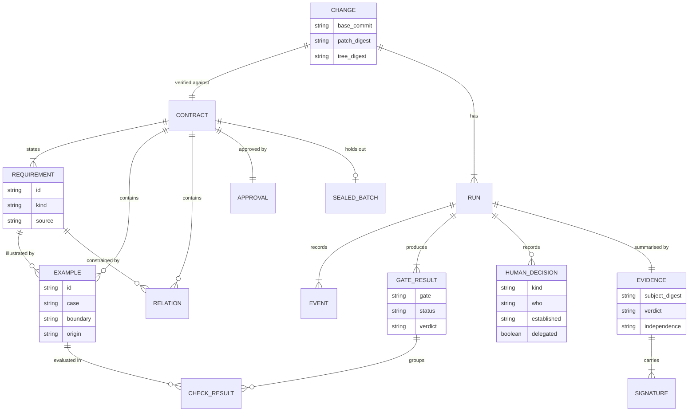
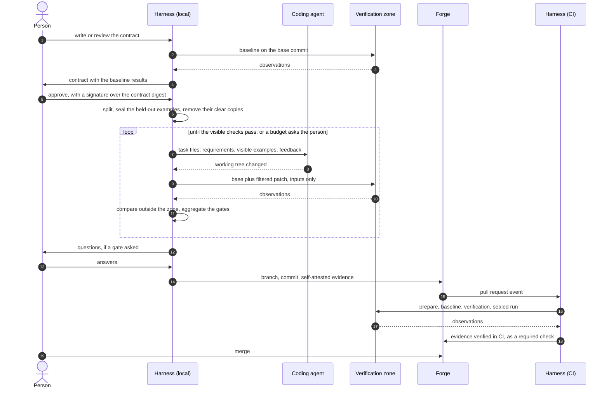

# Data and evidence

*Leer en [español](03-data-and-evidence.es.md).*

What the harness writes down, where it keeps it and what the evidence of a change contains. The
terms are those of the [glossary](glossary.md).

The formats shown here are the starting point for block A. The first milestone of that block
writes three real contracts by hand ([roadmap](../ROADMAP.md)); if they do not fit, the formats
change before any code depends on them. The names of files and directories are provisional.

## The data



## Where it lives

One layout, whether it is kept in the repository or, for a single developer, in a local directory
without git ([ADR-0027](../adr/0027-memory-has-one-layout-and-three-scopes.md)).

| Scope | What | Where |
|---|---|---|
| Project | Policy, pack, flow, list of allowed signers, memory files | `.dokime/` |
| Change | Contract, clarifications, approval, sealed batch | `.dokime/changes/<story>/`, on the branch of the change |
| Person | Ledger of each run, stored artifacts, proposals not yet approved, the key when it is local | The state directory of the harness, outside the working tree |

Two rules follow from decisions already taken:

- **Evidence never lives inside the tree it describes.** Its subject is the digest of the tree, and
  a file added to the tree would change that digest. It is kept by the evidence store: a file next
  to the pull request, git notes or the attestation store of the forge.
- **The list of allowed signers, the policy, the pack and the flow are protected paths.** A change
  to them made by the agent is dropped from the patch.

## The contract

A YAML file with requirements, examples and relations
([ADR-0011](../adr/0011-contract-of-requirements-and-approved-examples.md),
[ADR-0012](../adr/0012-examples-are-observations-at-a-boundary.md)).

```yaml
format: 1                       # version of the file format
story: invoice-rounding         # identifies the contract
may_modify_tests: []            # test files the change is allowed to edit

requirements:
  - id: round-total-once        # descriptive, chosen by the person
    kind: new                   # new | change | preserve
    text: When an invoice has lines in several currencies, the system shall round the total once.
    source: written             # written | imported, with the tool and the file it came from
  - id: round-each-line-first
    kind: change
    replaces: round-per-line    # only on a change: the behaviour it replaces
    text: …
    source: written

examples:
  - id: E-4f1a                  # opaque, random, assigned once by the harness
    requirement: round-total-once
    case: normal
    boundary: cli               # function | cli | http
    target: invoice             # what is called: a command, a function or a route
    description: Two lines in euros whose sum needs rounding.   # optional, one line
    origin: human               # a proposal has origin model until a person accepts it
    steps:
      - input:
          args: [total, invoice.json]
          files: {invoice.json: {$json: {lines: [{amount: 3.335, currency: EUR}, {amount: 6.695, currency: EUR}]}}}
        expect:
          exit: 0
          stdout: {$json: {total: {$approx: 10.03, tolerance: 0.005}}}
          files: {}             # files that must exist afterwards, when the boundary is cli

relations:
  - id: L1
    requirement: round-total-once
    relation: order-insensitive   # from the closed catalogue: idempotent | order-insensitive
    target: invoice
    over: lines                   # the input whose order does not matter
```

- **What a step may expect** is an exact value or one of the matchers of the closed catalogue: any
  identifier or timestamp (`$any`), approximate number (`$approx`), unordered collection
  (`$unordered`), contains (`$contains`), pattern (`$pattern`), reference to an earlier step
  (`$ref`). The catalogue of relations includes `idempotent` (applying the
  operation twice gives what applying it once gives).
- **The fields of an example are closed**
  ([ADR-0039](../adr/0039-what-a-contract-of-the-first-version-may-say.md)). At the `function`
  boundary the input is `args` and `kwargs`, and the expectation is `returns` or `raises`. At
  `cli` the input is `args`, `stdin`, `files` and `env`, and the expectation is `exit`, `stdout`,
  `stderr` and `files`. What `expect` does not declare is not compared. The first version does not
  check examples at `http` nor the matcher `$ref`, and says so with the verdict `ERROR`.
- **Every example says its origin**, `human` or `model`. There is no default.
- **A contradiction and a duplicate are defects.** Two examples with the same boundary, target and
  inputs contradict when their expectations cannot both hold; they are duplicates when their steps
  are the same.
- **The requirement text is canonical in English.** The person may be shown another language; the
  approval records the digest of what was shown
  ([ADR-0032](../adr/0032-bilingual-interaction-signs-what-was-shown.md)).
- **A requirement says where it came from.** One imported from a specification made with another
  tool is a proposal like any other
  ([ADR-0033](../adr/0033-a-specification-from-another-tool-enters-as-proposals.md)).
- **Identifiers.** A requirement id is descriptive, because the person reads it and chooses it.
  An example id is opaque and random, because an id derived from the content could be guessed and
  would say something about an example that is held out.
- **A multi-line text states its final newline.** A text of several lines, in an input or in an
  expectation, is written with the directive `$text`, as a literal block, with a mandatory
  `final_newline`:

  ```yaml
  stdout:
    $text: |
      total: 10.03
      lines: 2
    final_newline: true
  ```

  The block always gives a value that ends in one newline; `final_newline: false` removes it to
  get the real text, and `true` keeps it. Whether a text ends in a newline decides whether an
  example passes, and it must not hang on a hyphen that nobody sees.
- **Directives are marked with `$`**
  ([ADR-0038](../adr/0038-directives-in-a-contract-are-marked-with-a-dollar.md)). A mapping with a
  key that starts with `$` is an instruction to the harness: `$text`, `$json`, `$literal` and the
  matchers. Every other mapping is data as written, so a function that returns a mapping with a
  key `approx` is not mistaken for a matcher.
- **A contract is read by strict rules of its own**
  ([ADR-0037](../adr/0037-a-contract-is-read-by-strict-rules-of-its-own.md)). One document, no
  anchors, aliases, tags or merge keys. A repeated key or id is a defect. A value without quotes
  that YAML readers type differently (`no`, `010`, `1.10`, a date, an empty value) is rejected,
  asking for quotes. A text on several lines that is not a literal block is rejected. The
  validator reports every finding in one run, each with its lines.
- **An example does not widen its requirement.** If an example fixes a behaviour that the text of
  its requirement does not state (a negative number, an empty list), the requirement is changed
  first, with the person's approval, or the example is not written. The interview applies this
  rule, and it asks the person about an edge case instead of deciding it inside an example.
- **Comments in a contract** are written in English and say something. They are outside the digest
  and the signature, so a comment never states anything that needs approval: that goes in the
  text, the `description` or an example. Unknown fields are rejected by the validator.
- **What the person is shown to approve** marks what the file does not show: trailing spaces and
  the final newline are drawn visibly.

### The digest of a contract

The digest has to stay verifiable after the split, when the content of the held-out examples is
no longer in the file. So it is computed over the digests of its parts, not over the file:

1. Each requirement, example and relation has the digest of its canonical form. The digest of an
   example is computed with a random salt that is kept with the example. Without it, a held-out
   example with a short, guessable content could be found by trying candidates against its digest.
2. The digest of the contract is the digest of the header and the ordered list of those digests.
3. After the split, the file keeps the visible examples whole and, for each held-out example, only
   its identifier, requirement, case and digest. The salt of a held-out example stays under the
   key, not in the file.

Anyone can recompute the digest of the contract from the file. Only who holds the key can check
that a held-out digest matches its content.

### The approval

```json
{
  "contract": "sha256:c07e…",
  "shown": {"language": "es", "digest": "sha256:aa31…"},
  "who": "rafa",
  "established": "signed",
  "gesture_enforced": true,
  "specified_behind": "wrapper",
  "at": "2026-11-10T15:40:02Z",
  "signature": "…"
}
```

`specified_behind` is the barrier between the place where the contract was specified and the
agent: `other-machine`, `wrapper`, `other-user` or `none`
([ADR-0020](../adr/0020-agent-isolation-is-optional-adoption-is-a-ladder.md)). `gesture_enforced`
says whether the key agent asked for confirmation or a hardware key was touched
([ADR-0024](../adr/0024-approval-attestation-and-commit-are-signed-separately.md)).

## The ledger

Each run appends events to one file. Every event stores the hash of the previous one
([ADR-0023](../adr/0023-evidence-is-an-attestation-bound-to-the-tree.md)).

```json
{"seq": 41, "at": "2026-11-10T16:02:11Z", "type": "gate.finished",
 "gate": "visible-examples", "status": "run", "verdict": "PASS",
 "inputs": {"patch": "sha256:9f2c…", "image": "sha256:41ab…", "contract": "sha256:c07e…"},
 "prev": "sha256:77d0…", "hash": "sha256:e1b4…"}
```

| Event | Records |
|---|---|
| `run.started`, `run.finished` | The digests the run starts from; the final state |
| `state.entered` | The state of the flow |
| `gate.started`, `gate.finished` | The gate, its status, its verdict and the digests of its inputs |
| `human.asked`, `human.answered` | The question; the answer, who gave it, how that was established, whether delegated |
| `model.called` | The registered prompt, the model and the digest of the output, which is stored |
| `agent.started`, `agent.finished` | The agent profile, the model and the exit status |
| `baseline.unstable` | The tests excluded as unstable |
| `budget.exhausted` | The loop and the state that asks |
| `evidence.built` | The digest of the evidence |

Events refer to artifacts by digest; the artifacts are stored next to the ledger. Held-out content
is never among them: the ledger keeps its digest. The state of a run is computed from its ledger.

## The evidence

One in-toto statement in a DSSE envelope, with a predicate of our own. It is produced for every
finished run, whatever its verdict.

```json
{
  "_type": "https://in-toto.io/Statement/v1",
  "subject": [
    {"name": "tree", "digest": {"gitTree": "5b1e…"}},
    {"name": "change.patch", "digest": {"sha256": "9f2c…"}}
  ],
  "predicateType": "https://github.com/rafaranaz/raclab-dokime/attestation/conformance/v0.1",
  "predicate": {
    "verdict": "PASS",
    "delivered": true,
    "independence": "self-attested",
    "verifier": {"harness": "0.1.0", "ran_on": "developer"},
    "contract": {"story": "invoice-rounding", "digest": "sha256:c07e…", "approval": "sha256:19d4…"},
    "inputs": {
      "base": "e0ba503…",
      "image": {"digest": "sha256:41ab…", "platform": "linux/amd64"},
      "pack": {"digest": "sha256:77aa…", "level": "P2"},
      "policy": "sha256:0d5f…",
      "flow": "sha256:6c2a…",
      "seeds": {"holdout": "sha256:1f0c…", "relations": "sha256:8e21…"}
    },
    "author": {
      "step": 2, "agent": "example-agent", "agent_version": "1.4.0", "model": "example-model",
      "payment": "subscription", "wrapper": false
    },
    "gates": [
      {"gate": "protected-paths", "status": "run", "verdict": "PASS"},
      {"gate": "existing-tests", "status": "run", "verdict": "PASS",
       "checks": {"origin": "existing", "total": 412, "excluded_unstable": 2}},
      {"gate": "visible-examples", "status": "run", "verdict": "PASS",
       "checks": {"origin": "human", "total": 9}},
      {"gate": "sealed-examples", "status": "not-applicable", "reason": "the key lives only in CI"},
      {"gate": "changed-line-coverage", "status": "skipped", "reason": "optional in the policy"},
      {"gate": "behaviour-differences", "status": "not-applicable", "reason": "pack level P2"}
    ],
    "human_decisions": [
      {"kind": "gate-question", "gate": "model-review", "answer": "not a defect",
       "who": "rafa", "established": "declared", "delegated": false, "at": "2026-11-10T16:20:45Z"}
    ],
    "not_checked": [
      {"code": "no-holdout", "what": "R4", "reason": "no case with two examples"},
      {"code": "gate-skipped", "what": "changed-line-coverage", "reason": "optional in the policy"},
      {"code": "outside-threat-model", "what": "existing-tests", "reason": "they run in the process of the code under test"}
    ],
    "attempts": {"count": 3, "sealed_failures": 0, "disputes": 0},
    "repeated": {"runs": 2, "consistent": true},
    "ledger": {"head": "sha256:e1b4…", "events": 87},
    "informative": {
      "change": {"files": 4, "lines_added": 87, "lines_removed": 12},
      "mutation": {"total": 20, "killed": 17},
      "cost": {"amount": 0.42, "currency": "USD"}
    }
  }
}
```

- **`gates`** lists every gate of the flow with one of four statuses: `run`, `skipped`,
  `not-applicable` or `not-reached`. The last three carry a reason computed by the harness. A gate
  is `not-reached` only in a run that an earlier gate stopped.
- **`not_checked`** is mandatory and filled mechanically. Each entry has a code from a closed list
  and a reason in words. The list starts with: `no-holdout`, `requirement-without-example`,
  `only-model-checks`, `gate-skipped`, `test-excluded-unstable`, `test-excluded-network`,
  `boundary-not-supported`, `best-effort-secrecy`, `outside-threat-model`.
- **`independence`** is `self-attested`, `ci-verified` or `ci-verified, second-approver`.
- **`informative`** is read by no gate and decides nothing.
- **For sealed checks** it carries digests and classes of failure, never values or inputs.
- Where a field means the same as one of the verification summary of SLSA, it uses that name, so a
  summary in that format can be produced from the evidence later. That format alone was not
  enough: its result is only passed or failed, and it has no place for what was not checked.

### Verifying and replaying

| Command | Depends on | What it does |
|---|---|---|
| Verify | `evidence`, `core`, git and the public verifier of the signature scheme | Checks the signatures against the list of allowed signers, the schema, that the digest of the subject matches the tree, the chain of the ledger and the gates against the flow file. It runs nothing |
| Replay | The whole harness | Runs the gates again from the ledger and the stored artifacts, using the recorded answers and model outputs, and compares verdicts. Sealed gates only where the key is |

## A change from end to end



When a change arrives already made, the loop is skipped: the harness starts at the verification.
