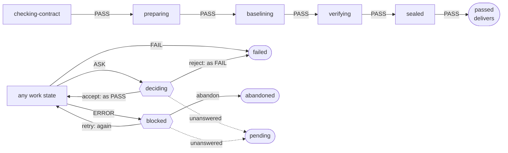
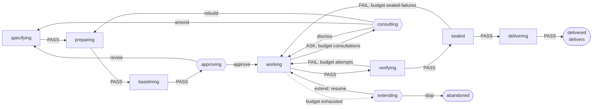

<!-- translation-of: 04-states-and-flows.md sha256:d4f9c821067de4e0 -->
# Estados y flujos

*Read in [English](04-states-and-flows.md).*

Cómo pasa una ejecución de un paso al siguiente. El flujo es un fichero YAML
([ADR-0018](../adr/0018-the-flow-is-a-state-machine-in-a-yaml-file.es.md)); este documento fija
qué puede decir el fichero, qué rechaza el validador y los dos flujos con los que arranca el
producto. Los términos son los del [glosario](glossary.es.md); los datos que deja una ejecución
están en [03-data-and-evidence.es.md](03-data-and-evidence.es.md).

## Qué puede decir el fichero

Un flujo tiene tres tipos de estado y nada más. No tiene condiciones, ni expresiones, ni código:
la lógica está en las puertas.

| Tipo | Qué tiene | Qué ocurre ahí |
|---|---|---|
| Estado de trabajo | Una o más puertas, y una transición para cada uno de los cuatro veredictos | Las puertas se ejecutan; sus veredictos se agregan ([ADR-0034](../adr/0034-a-state-closes-with-the-aggregated-verdict-of-its-gates.es.md)) y se sigue la transición del resultado |
| Estado de pregunta | Una pregunta, una lista cerrada de respuestas con el destino de cada una, y dónde termina la ejecución si nadie puede responder | Responde una persona. En un modo sin preguntas la ejecución termina ahí como pendiente |
| Estado final | Si entrega o no | La ejecución termina y se construye su evidencia |

Una transición es el nombre de un estado. Una transición que puede repetirse lleva un
**presupuesto** y el estado de pregunta al que va la ejecución cuando el presupuesto se agota. Las
cantidades están en la política, no en el flujo.

Una respuesta lleva a un estado con nombre, o a uno de tres sitios que dependen de desde dónde se
hizo la pregunta:

| La respuesta lleva a | Significado | Permitido cuando |
|---|---|---|
| `again` | El estado que preguntó vuelve a ejecutar sus puertas | Siempre |
| `{as: PASS}` o `{as: FAIL}` | La respuesta ocupa el lugar del veredicto: el flujo sigue la transición que el estado que preguntó tiene para él | `as: PASS` solo si a la pregunta se llega únicamente por `ASK` |
| `resume` | Se sigue la transición cuyo presupuesto se agotó, con el presupuesto renovado | Solo si a la pregunta se llega únicamente por un presupuesto agotado |

Las transiciones de un estado de trabajo van bajo la clave `then`. La más natural, `on`, la leen
como un booleano los analizadores de YAML, y el primer borrador de estos ficheros tropezó con
ello.

## Qué rechaza el validador

El fichero se valida al cargarlo, y una ejecución no arranca sobre un flujo que falla. Las reglas
son lo que hace que INV-5, INV-6 y parte de INV-7 se cumplan por construcción.

| El validador rechaza | Protege |
|---|---|
| Un campo desconocido, un estado que falta, un estado al que no se llega desde el inicio | El fichero solo dice lo que el esquema permite |
| Un estado de trabajo sin puerta, o sin transición para cada uno de los cuatro veredictos | INV-5: todo estado no final tiene salida para cada resultado |
| Un estado desde el que no se alcanza ningún estado final | INV-5 |
| Un bucle entre estados de trabajo sin presupuesto en ninguna de sus transiciones | INV-5: todo bucle tiene presupuesto |
| Un presupuesto no declarado en el flujo, o cuyo agotamiento no lleva a un estado de pregunta | INV-5: agotar un presupuesto pregunta a una persona |
| Una transición de `FAIL` o de `ERROR` hacia un estado que entrega | INV-6 |
| Una respuesta `as: PASS` en una pregunta a la que puede llegar un `ERROR` o un `FAIL` | INV-6: nadie puede dar por bueno un error, y un presupuesto agotado no es un aprobado |
| Una respuesta que lleva directamente a un estado que entrega | La entrega sigue a un `PASS`, nunca a una respuesta sola |
| Una pregunta cuyo final sin respuesta no es un estado final, o es uno que entrega | Una ejecución sin nadie a quien preguntar nunca entrega |
| Un estado final que no dice si entrega | INV-6 se puede comprobar desde el fichero |

Los dos flujos de más abajo se pasaron por un borrador de estas reglas, junto con quince variantes
rotas de ellos, al menos una por regla; los dos se aceptaron y las quince se rechazaron. Ese
borrador no forma parte del repositorio: el validador se escribe con sus tests cuando se abra su
módulo.

## Las puertas

Una puerta es código. Devuelve un veredicto y, para la evidencia, un estado y sus comprobaciones.

| Puerta | `FAIL` cuando | `ASK` cuando | Bloque |
|---|---|---|---|
| `contract` | El contrato incumple su esquema, tiene ejemplos contradictorios, o su aprobación no está firmada por un firmante permitido | Un requisito no tiene ejemplo, o solo tiene comprobaciones de origen `model` | A |
| `environment` | Falla la autocomprobación del pack | — | A |
| `baseline` | Un ejemplo de un requisito `preserve` falla sobre el commit base | Un ejemplo de un requisito `new` o `change` ya pasa sobre el commit base | A |
| `protected-paths` | Un cambio que llega ya hecho toca una ruta protegida que el contrato no declara | — | A |
| `existing-tests` | Un test que pasaba en la línea base falla o desaparece | — | A |
| `visible-examples` | Falla un ejemplo visible de origen `human` o `derived` | Falla una comprobación de origen `model` | A |
| `repeatability` | — | Dos ejecuciones de la verificación dan veredictos distintos | A |
| `relations` | Una relación aprobada no se cumple en una entrada generada | — | B |
| `sealed-examples` | Falla un ejemplo reservado, o pasa el canario | — | B |
| `agent-run` | El agente termina sin ningún cambio | El agente impugna una comprobación o pide una dependencia | C |
| `changed-line-coverage` | — | La cobertura de las líneas de producción cambiadas está por debajo del límite de la política | D |
| `behaviour-differences` | — | El cambio altera comportamiento fuera del contrato | D |
| `delivery` | Se rechaza el commit o la adjunción de la evidencia | — | E |

Toda puerta devuelve `ERROR` cuando no pudo evaluar. Una puerta que todavía no existe en un bloque
aparece en la evidencia como no aplicable, con ese motivo. Cuando el agente trabaja bajo el arnés,
`protected-paths` restaura los ficheros protegidos y continúa en lugar de fallar
([ADR-0016](../adr/0016-verification-in-a-container-on-base-plus-patch.es.md)).

## El flujo de auditoría

Para un cambio que llega ya hecho: los dos primeros peldaños de la escalera de adopción
([ADR-0020](../adr/0020-agent-isolation-is-optional-adoption-is-a-ladder.es.md)). Es el flujo del
bloque A.



```yaml
flow: 1
name: audit
start: checking-contract
budgets: []

states:
  checking-contract:
    gates: [contract]
    then: {PASS: preparing, FAIL: failed, ASK: deciding, ERROR: blocked}
  preparing:
    gates: [environment]
    then: {PASS: baselining, FAIL: failed, ASK: deciding, ERROR: blocked}
  baselining:
    gates: [baseline]
    then: {PASS: verifying, FAIL: failed, ASK: deciding, ERROR: blocked}
  verifying:
    gates: [protected-paths, existing-tests, visible-examples, relations, changed-line-coverage, behaviour-differences, repeatability]
    then: {PASS: sealed, FAIL: failed, ASK: deciding, ERROR: blocked}
  sealed:
    gates: [sealed-examples]
    then: {PASS: passed, FAIL: failed, ASK: deciding, ERROR: blocked}

  deciding:
    question: a gate asked
    answers: {accept: {as: PASS}, reject: {as: FAIL}}
    unanswered: pending
  blocked:
    question: a gate could not evaluate
    answers: {retry: again, abandon: abandoned}
    unanswered: pending

  passed: {final: true, delivers: true}
  failed: {final: true, delivers: false}
  abandoned: {final: true, delivers: false}
  pending: {final: true, delivers: false}
```

En el flujo de auditoría, "entrega" significa adjuntar la evidencia de aceptación: el commit ya
existe.

## El flujo completo

Para un cambio que el arnés dirige desde el contrato hasta la entrega. Es un esbozo: su detalle se
fija cuando se abra el bloque C, con lo que enseñen los bloques A y B.



El diagrama omite, para cada estado de trabajo, `ASK` hacia `deciding` y `ERROR` hacia `blocked`,
que son como en el flujo de auditoría, y el final `pending` de cada pregunta.

```yaml
flow: 1
name: full
start: specifying
budgets: [attempts, sealed-failures, consultations]

states:
  specifying:
    gates: [contract]
    then: {PASS: preparing, FAIL: specifying-again, ASK: deciding, ERROR: blocked}
  preparing:
    gates: [environment]
    then: {PASS: baselining, FAIL: specifying-again, ASK: deciding, ERROR: blocked}
  baselining:
    gates: [baseline]
    then: {PASS: approving, FAIL: specifying-again, ASK: deciding, ERROR: blocked}
  working:
    gates: [agent-run]
    then:
      PASS: verifying
      FAIL: {to: working, budget: attempts, exhausted: extending}
      ASK: {to: consulting, budget: consultations, exhausted: extending}
      ERROR: blocked
  verifying:
    gates: [protected-paths, existing-tests, visible-examples, relations, changed-line-coverage, behaviour-differences, repeatability]
    then:
      PASS: sealed
      FAIL: {to: working, budget: attempts, exhausted: extending}
      ASK: deciding
      ERROR: blocked
  sealed:
    gates: [sealed-examples]
    then:
      PASS: delivering
      FAIL: {to: working, budget: sealed-failures, exhausted: extending}
      ASK: deciding
      ERROR: blocked
  delivering:
    gates: [delivery]
    then: {PASS: delivered, FAIL: abandoned, ASK: deciding, ERROR: blocked}

  specifying-again:
    question: the contract or its environment has a defect
    answers: {revise: specifying, abandon: abandoned}
    unanswered: pending
  approving:
    question: approve the contract, with the baseline in view
    answers: {approve: working, revise: specifying, abandon: abandoned}
    unanswered: pending
  consulting:
    question: the agent disputes a check or asks for a dependency
    answers: {dismiss: working, amend: specifying, rebuild: preparing}
    unanswered: pending
  deciding:
    question: a gate asked
    answers: {accept: {as: PASS}, reject: {as: FAIL}}
    unanswered: pending
  extending:
    question: a budget is exhausted
    answers: {extend: resume, stop: abandoned}
    unanswered: pending
  blocked:
    question: a gate could not evaluate
    answers: {retry: again, abandon: abandoned}
    unanswered: pending

  delivered: {final: true, delivers: true}
  abandoned: {final: true, delivers: false}
  pending: {final: true, delivers: false}
```

## Reglas que no están en el fichero

Hay comportamiento que es igual para todos los flujos y pertenece al motor, de modo que un flujo
no puede cambiarlo:

- **Un `ERROR` se reintenta una vez** antes de seguir su transición
  ([ADR-0015](../adr/0015-a-gate-returns-one-of-four-verdicts.es.md)).
- **Una persona puede abandonar una ejecución** desde cualquier estado. Termina en el estado final
  llamado `abandoned`.
- **Un modo sin preguntas** termina la ejecución en el primer estado de pregunta, en su final sin
  respuesta. La ejecución se repite cuando una persona ha respondido.
- **Los presupuestos se cuentan desde el registro**, así que sobreviven a un reinicio.
- **La ejecución sellada solo ocurre donde está la clave.** En otro sitio la puerta no es
  aplicable y la evidencia lo dice.

## Quién lee el fichero

Cargar y validar un flujo se hace en `core`, sin entrada ni salida propias, porque el bloque A ya
necesita la lista de puertas de un flujo para su evidencia. Ejecutar un flujo con bucles,
presupuestos y un agente es trabajo de `engine`, en el bloque C
([ADR-0035](../adr/0035-the-flow-is-loaded-and-validated-in-core.es.md)).
