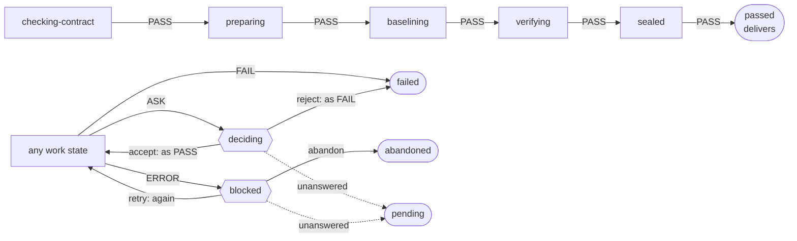
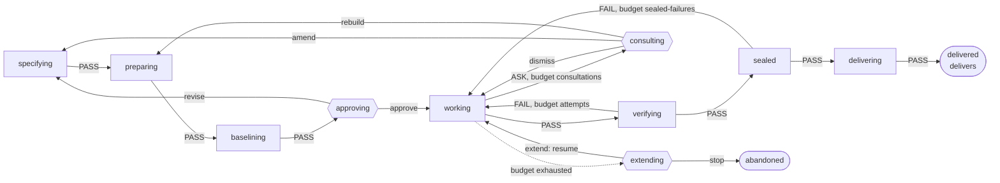

# States and flows

*Leer en [español](04-states-and-flows.es.md).*

How a run moves from one step to the next. The flow is a YAML file
([ADR-0018](../adr/0018-the-flow-is-a-state-machine-in-a-yaml-file.md)); this document fixes what
the file can say, what the validator rejects and the two flows the product starts with. The terms
are those of the [glossary](glossary.md); the data a run leaves behind is in
[03-data-and-evidence.md](03-data-and-evidence.md).

## What the file can say

A flow has three kinds of state and nothing else. It has no conditions, no expressions and no
code: the logic is in the gates.

| Kind | What it has | What happens there |
|---|---|---|
| Work state | One or more gates, and a transition for each of the four verdicts | The gates run; their verdicts are aggregated ([ADR-0034](../adr/0034-a-state-closes-with-the-aggregated-verdict-of-its-gates.md)) and the transition for the result is followed |
| Question state | A question, a closed list of answers and where each leads, and where the run ends if nobody can answer | A person answers. In a mode without questions the run ends there as pending |
| Final state | Whether it delivers | The run ends and its evidence is built |

A transition is the name of a state. A transition that can repeat carries a **budget** and the
question state the run goes to when the budget is exhausted. The amounts are in the policy, not
in the flow.

A budget never ends a run and never lets it continue on its own. It marks the point at which a
person is asked, with what the attempts so far have shown; the person extends it or stops.

An answer leads to a named state, or to one of three places that depend on where the question was
asked from:

| Answer leads to | Meaning | Allowed when |
|---|---|---|
| `again` | The state that asked runs its gates again | Always |
| `{as: PASS}` or `{as: FAIL}` | The answer stands in for the verdict: the flow follows the transition the asking state has for it | `as: PASS` only if the question is reached by `ASK` alone |
| `resume` | The transition whose budget was exhausted is followed, with the budget renewed | Only if the question is reached by an exhausted budget alone |

The transitions of a work state are under the key `then`. The more natural `on` is read as a
boolean by YAML parsers, which the first draft of these files ran into.

## What the validator rejects

The file is validated when it is loaded, and a run does not start on a flow that fails. The rules
are what makes INV-5, INV-6 and part of INV-7 hold by construction.

| The validator rejects | It protects |
|---|---|
| An unknown field, a missing state, a state that cannot be reached from the start | The file says only what the schema allows |
| A work state without a gate, or without a transition for each of the four verdicts | INV-5: every non-final state has an exit for every outcome |
| A state from which no final state can be reached | INV-5 |
| A loop among work states with no budget on any of its transitions | INV-5: every loop has a budget |
| A budget not declared in the flow, or whose exhaustion does not lead to a question state | INV-5: exhausting a budget asks a person |
| A `FAIL` or `ERROR` transition into a state that delivers | INV-6 |
| An answer `as: PASS` in a question that an `ERROR` or a `FAIL` can reach | INV-6: nobody can accept an error, and an exhausted budget is not a pass |
| An answer that leads straight to a state that delivers | Delivery follows a `PASS`, never an answer alone |
| A question whose unanswered end is not a final state, or is one that delivers | A run with no person to ask never delivers |
| A final state that does not say whether it delivers | INV-6 can be checked from the file |

The two flows below were run through a draft of these rules, together with fifteen broken
variants of them, at least one per rule; the two were accepted and the fifteen rejected. That
draft is not part of the repository: the validator is written with its tests when its module
opens.

## The gates

A gate is code. It returns a verdict and, for the evidence, a status and its checks.

| Gate | `FAIL` when | `ASK` when | Block |
|---|---|---|---|
| `contract` | The contract breaks its schema, has contradictory examples, or its approval is not signed by an allowed signer | A requirement has no example, or only checks of origin `model` | A |
| `environment` | The self-check of the pack fails | — | A |
| `baseline` | An example of a `preserve` requirement fails on the base commit | An example of a `new` or `change` requirement already passes on the base commit | A |
| `protected-paths` | A change that arrives already made touches a protected path the contract does not declare | — | A |
| `existing-tests` | A test that passed in the baseline fails or disappears | — | A |
| `visible-examples` | A visible example of origin `human` or `derived` fails | A check of origin `model` fails | A |
| `repeatability` | — | Two runs of the verification give different verdicts | A |
| `relations` | An approved relation does not hold on a generated input | — | B |
| `sealed-examples` | A held-out example fails, or the canary passes | — | B |
| `agent-run` | The agent ends without a change | The agent disputes a check or asks for a dependency | C |
| `changed-line-coverage` | — | Coverage of the changed production lines is under the limit of the policy | D |
| `behaviour-differences` | — | The change alters behaviour outside the contract | D |
| `delivery` | The commit or the attachment of the evidence is refused | — | E |

Every gate returns `ERROR` when it could not evaluate. A gate that does not exist yet in a block
appears in the evidence as not applicable, with that reason. When the agent works under the
harness, `protected-paths` restores the protected files and continues instead of failing
([ADR-0016](../adr/0016-verification-in-a-container-on-base-plus-patch.md)).

## The audit flow

For a change that arrives already made: the first two steps of the adoption ladder
([ADR-0020](../adr/0020-agent-isolation-is-optional-adoption-is-a-ladder.md)). It is the flow of
block A.



```yaml
flow: 1
name: audit
start: checking-contract
budgets: []

states:
  checking-contract:
    gates: [contract]
    then: {PASS: preparing, FAIL: failed, ASK: deciding, ERROR: blocked}
  preparing:
    gates: [environment]
    then: {PASS: baselining, FAIL: failed, ASK: deciding, ERROR: blocked}
  baselining:
    gates: [baseline]
    then: {PASS: verifying, FAIL: failed, ASK: deciding, ERROR: blocked}
  verifying:
    gates: [protected-paths, existing-tests, visible-examples, relations, changed-line-coverage, behaviour-differences, repeatability]
    then: {PASS: sealed, FAIL: failed, ASK: deciding, ERROR: blocked}
  sealed:
    gates: [sealed-examples]
    then: {PASS: passed, FAIL: failed, ASK: deciding, ERROR: blocked}

  deciding:
    question: a gate asked
    answers: {accept: {as: PASS}, reject: {as: FAIL}}
    unanswered: pending
  blocked:
    question: a gate could not evaluate
    answers: {retry: again, abandon: abandoned}
    unanswered: pending

  passed: {final: true, delivers: true}
  failed: {final: true, delivers: false}
  abandoned: {final: true, delivers: false}
  pending: {final: true, delivers: false}
```

In the audit flow "delivers" means attaching evidence of acceptance: the commit already exists.

## The full flow

For a change the harness drives from the contract to the delivery. It is an outline: its detail
is fixed when block C opens, with what blocks A and B teach.



The diagram leaves out, for every work state, `ASK` to `deciding` and `ERROR` to `blocked`, which
are as in the audit flow, and the `pending` end of every question.

```yaml
flow: 1
name: full
start: specifying
budgets: [attempts, sealed-failures, consultations]

states:
  specifying:
    gates: [contract]
    then: {PASS: preparing, FAIL: specifying-again, ASK: deciding, ERROR: blocked}
  preparing:
    gates: [environment]
    then: {PASS: baselining, FAIL: specifying-again, ASK: deciding, ERROR: blocked}
  baselining:
    gates: [baseline]
    then: {PASS: approving, FAIL: specifying-again, ASK: deciding, ERROR: blocked}
  working:
    gates: [agent-run]
    then:
      PASS: verifying
      FAIL: {to: working, budget: attempts, exhausted: extending}
      ASK: {to: consulting, budget: consultations, exhausted: extending}
      ERROR: blocked
  verifying:
    gates: [protected-paths, existing-tests, visible-examples, relations, changed-line-coverage, behaviour-differences, repeatability]
    then:
      PASS: sealed
      FAIL: {to: working, budget: attempts, exhausted: extending}
      ASK: deciding
      ERROR: blocked
  sealed:
    gates: [sealed-examples]
    then:
      PASS: delivering
      FAIL: {to: working, budget: sealed-failures, exhausted: extending}
      ASK: deciding
      ERROR: blocked
  delivering:
    gates: [delivery]
    then: {PASS: delivered, FAIL: abandoned, ASK: deciding, ERROR: blocked}

  specifying-again:
    question: the contract or its environment has a defect
    answers: {revise: specifying, abandon: abandoned}
    unanswered: pending
  approving:
    question: approve the contract, with the baseline in view
    answers: {approve: working, revise: specifying, abandon: abandoned}
    unanswered: pending
  consulting:
    question: the agent disputes a check or asks for a dependency
    answers: {dismiss: working, amend: specifying, rebuild: preparing}
    unanswered: pending
  deciding:
    question: a gate asked
    answers: {accept: {as: PASS}, reject: {as: FAIL}}
    unanswered: pending
  extending:
    question: a budget is exhausted
    answers: {extend: resume, stop: abandoned}
    unanswered: pending
  blocked:
    question: a gate could not evaluate
    answers: {retry: again, abandon: abandoned}
    unanswered: pending

  delivered: {final: true, delivers: true}
  abandoned: {final: true, delivers: false}
  pending: {final: true, delivers: false}
```

## Rules that are not in the file

Some behaviour is the same for every flow and belongs to the engine, so that a flow cannot change
it:

- **An `ERROR` is retried once** before its transition is followed
  ([ADR-0015](../adr/0015-a-gate-returns-one-of-four-verdicts.md)).
- **A person can abandon a run** from any state. It ends in the final state named `abandoned`.
- **A mode without questions** ends the run at the first question state, in its unanswered end.
  The run is repeated when a person has answered.
- **Budgets are counted from the ledger**, so they survive a restart.
- **The sealed run happens only where the key is.** Elsewhere the gate is not applicable and the
  evidence says so.

## Who reads the file

Loading and validating a flow is done in `core`, without input or output of its own, because
block A already needs the list of gates of a flow for its evidence. Executing a flow with loops,
budgets and an agent is the job of `engine`, in block C
([ADR-0035](../adr/0035-the-flow-is-loaded-and-validated-in-core.md)).
